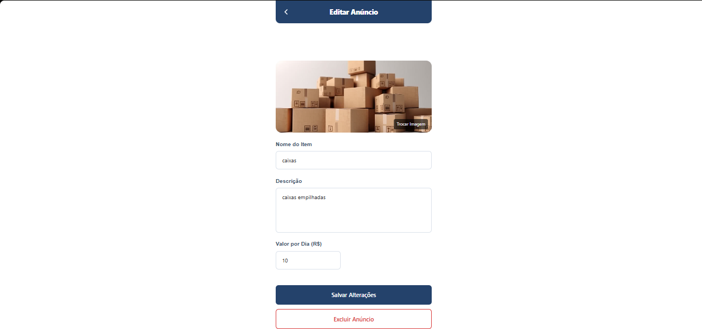

# GearUp

Aplicação web para anunciar e alugar itens em geral, pensada para ajudar pequenos comerciantes e
qualquer pessoa que queira alugar o que tem parado em casa. O usuário cadastra anúncios com título,
descrição, valor por dia e foto, e pode listar, editar e excluir os anúncios em uma interface
simples.

Projeto acadêmico de Engenharia de Software — Centro Universitário FAG.

**Integrantes:** Wellington Davies dos Santos, Bruno Henrique da Silva e Flavio Antônio Schneider.


## Arquitetura

```
 Navegador                                   API REST local
 Preact + TypeScript (Vite)   ──── HTTP ───►  JSON Server
 páginas → itemService.ts     ◄─── JSON ────  db.json
   :5173                                        :3001
```

O front-end só conhece a URL da API (`VITE_API_URL`). Toda chamada HTTP passa por
`src/services/itemService.ts`, então trocar o JSON Server por um back-end real é mudar só esse
endereço.

| Camada       | Elementos                                                                 |
| ------------ | ------------------------------------------------------------------------- |
| Interface    | Páginas em `src/pages` e componentes em `src/components`                  |
| Serviço      | `itemService.ts`: CRUD de anúncios com tratamento de erro único           |
| Dados        | JSON Server servindo `db.json` (protótipo); modelo relacional em `docs/`  |

## Estrutura do repositório

```
aplicacao/                     front-end (Preact + TypeScript + Vite)
├── db.json                    dados usados pelo JSON Server
├── iniciar.bat                sobe API e front-end no Windows
├── .env.example               modelo de configuração (URL da API)
└── src/
    ├── pages/                 Home (cadastro), Login, Itens, AddItem, EditItem
    ├── components/            CardItens, ImageUpload, BackButton
    ├── services/itemService.ts
    ├── utils/                 formatação de moeda, leitura de imagem, imagem padrão
    ├── types/item.ts
    └── styles/
docs/
├── documento-de-requisitos.pdf
├── gearup.sql                 script do banco relacional (MySQL)
├── modelo-banco.png
├── tabela-de-participacao.pdf
└── evidencias/                capturas de tela e vídeos da apresentação
```

## Como executar

Requisitos: Node.js (LTS) e npm.

```bash
cd aplicacao
npm install
npm run server     # API em http://localhost:3001
```

Em outro terminal:

```bash
cd aplicacao
npm run dev        # abre em http://localhost:5173
```

No Windows, também é possível dar dois cliques em `aplicacao/iniciar.bat`, que abre as duas
janelas.

## Configuração

| Exemplo (versionado)       | Arquivo real (ignorado pelo Git) | Variável       |
| -------------------------- | -------------------------------- | -------------- |
| `aplicacao/.env.example`   | `aplicacao/.env`                 | `VITE_API_URL` |

Sem o `.env`, a aplicação usa `http://localhost:3001`, que é onde o `npm run server` sobe a API.

## Rotas

| Rota                   | Tela                                   |
| ---------------------- | -------------------------------------- |
| `/`                    | Criar conta                            |
| `/login`               | Entrar                                 |
| `/itens`               | Meus anúncios (listagem e exclusão)    |
| `/anuncio/novo`        | Cadastro de anúncio com foto           |
| `/anuncio/editar/:id`  | Edição e exclusão de anúncio           |

## API (JSON Server)

| Método   | Endpoint       | Uso                          |
| -------- | -------------- | ---------------------------- |
| `GET`    | `/items`       | Lista os anúncios            |
| `GET`    | `/items/:id`   | Busca um anúncio             |
| `POST`   | `/items`       | Cria um anúncio              |
| `PUT`    | `/items/:id`   | Substitui um anúncio         |
| `PATCH`  | `/items/:id`   | Altera campos de um anúncio  |
| `DELETE` | `/items/:id`   | Remove um anúncio            |

Exemplo de anúncio:

```json
{"id":"P1NZJMt25Ag","titulo":"Parafusadeira amarela","descricao":"Fura e parafusa",
 "valorDia":60,"categoria":"Geral","cidade":"Não informada","disponivel":true}
```

## Funcionalidades

- Telas de criar conta e de login
- Listagem dos anúncios cadastrados, com imagem padrão quando o anúncio não tem foto
- Cadastro, edição e exclusão de anúncios
- Upload de foto com pré-visualização
- Valores exibidos em reais (R$ 60,00)
- Navegação entre telas com rotas

## Evidências

| Login                                   | Edição e exclusão                                    |
| --------------------------------------- | ---------------------------------------------------- |
|      |         |

Os vídeos da apresentação estão em `docs/evidencias/apresentacao-pt1.zip` e `apresentacao-pt2.zip`.

## Limitações

- Criar conta e login são apenas telas: não há autenticação, e o nome no topo da listagem é fixo.
- O JSON Server é um back-end de protótipo; o banco relacional de `docs/gearup.sql` ainda não está
  ligado à aplicação.
- As fotos são guardadas em base64 dentro do `db.json`, o que deixa o arquivo grande rapidamente.
- Não há busca nem filtro por categoria ou cidade, embora esses campos já existam nos dados.
